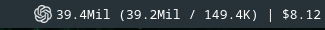

# Codex Token Stats

KDE Plasma 6 panel widget showing Codex token usage over the last 24 hours:



Click for the token and cost breakdown. Reads local sessions from `$CODEX_HOME`
(default `~/.codex`), refreshes every 30 seconds, and works offline.
Requires per-response records from Codex 0.160.0 or later.

Costs are API-equivalent USD estimates, not subscription charges. Bundled prices
need periodic updates; `--` means unavailable data or pricing.

## Install and develop

Requires Plasma 6 with Plasma5Support, Python 3, Make, and zip.
Checks and previews also need Plasma SDK and Qt 6 QML tools with QtTest.

```sh
make install   # then add Codex Token Stats from the widget picker
make check
make dev
make package
make uninstall
```

## Publish

Local Pling upload: install `uv`, copy `.env.example` to `.env`, fill in credentials,
then run `make pling-upload`.

GitHub: set variable `PLING_PROJECT_ID` and secrets `PLING_USERNAME` and
`PLING_PASSWORD`, then push a `release*` tag. **Uploads replace all existing
files on the Pling project.**

MIT. Based on [kde-6-widget-starter](https://github.com/ruinivist/kde-6-widget-starter).
